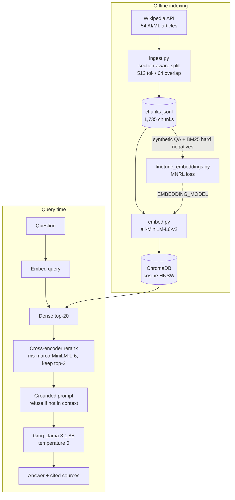

# rag-system

[](https://github.com/Faris-Maulana/rag-system/actions/workflows/ci.yml)
[](LICENSE)


A small, readable retrieval-augmented generation (RAG) system you can run on a laptop CPU. It answers
questions about AI/ML from 54 Wikipedia articles, using dense retrieval in ChromaDB, cross-encoder
reranking, and a Groq-hosted Llama 3.1 8B that must cite its sources. Around the core pipeline are the
parts that usually get skipped: synthetic-data fine-tuning of the embedding model (evaluated on a
held-out split), a corpus and retrieval bias audit with MMR, an LLM-as-judge evaluation harness, and a
retrieval-only evaluation that needs no API key. Each stage is one short script, so it works as a
reference implementation to read, fork and measure.

## Architecture



## Quickstart

Requires Python 3.11+ and a free [Groq API key](https://console.groq.com/keys).

```bash
git clone https://github.com/Faris-Maulana/rag-system.git && cd rag-system
make install    # virtualenv + pinned dependencies; creates .env from .env.example
# put your GROQ_API_KEY in .env, then:
make index demo # build the index (a few minutes on CPU), open http://127.0.0.1:7860
```

Or in one go once `.env` exists: `make quickstart`.

Other entry points:

| Command | What it does |
|---|---|
| `make query QUERY="What is backpropagation?"` | One question through the full pipeline in the terminal |
| `python src/retrieve.py --query "..."` | Retrieval + reranking only (no API key needed) |
| `make audit` | Corpus balance, chunk-length and MMR diversity report |
| `make eval-retrieval` | Context precision for dense vs reranked retrieval (no API key needed) |
| `make eval` | LLM-judge evaluation: faithfulness, answer relevancy, context precision |
| `make finetune` | Generate synthetic QA with Groq, fine-tune the embedder, report held-out MRR@10 |
| `make test` / `make lint` | Unit tests (no network or model downloads beyond the tokenizer) / ruff |

Configuration is through environment variables; see [`.env.example`](.env.example).

## Evaluation

All numbers below come from runs of the code in this repository, on an index built from Wikipedia on
2026-10-21. Wikipedia changes, so a fresh index will drift slightly.

### Retrieval: does the reranker earn its latency?

`make eval-retrieval`, 20 hand-written questions with reference answers
([`src/evaluate.py`](src/evaluate.py)), top-3 context. Raw per-query output is in
[`results/retrieval_report.json`](results/retrieval_report.json).

| Retrieval | Context precision |
|---|---|
| Dense top-3 (MiniLM, cosine) | 0.543 |
| Dense top-20 -> cross-encoder top-3 | **0.612** |

Reranking improved 10 of 20 queries, tied on 7 and hurt 3. The largest gain was
"Who invented the transformer architecture?" (0.29 -> 0.71).

Context precision here is a lexical proxy: the share of reference-answer keywords (words longer than
4 characters) that appear in the retrieved chunks. It is cheap and deterministic, but it is not RAGAS's
LLM-judged context precision, and it rewards keyword overlap rather than meaning.

### Generation: faithfulness and answer relevancy

`make eval` runs the full pipeline on the same 20 questions and scores answers with an LLM judge:
faithfulness (is every claim supported by the retrieved context, YES/NO) and answer relevancy
(0.0-1.0). The targets in the script are 0.80 and 0.75. **No generation scores are published yet**:
they need a Groq key, and the report from the original run was not kept. Run `make eval` to produce
`results/evaluation_report.json`. The metrics follow RAGAS definitions but are implemented directly,
so the `ragas` package is not a dependency.

### Embedding fine-tuning

`make finetune` generates one question per sampled chunk with Llama 3.1 8B, mines a BM25 hard
negative for each, and fine-tunes `all-MiniLM-L6-v2` with MultipleNegativesRankingLoss. MRR@10 is
reported on a held-out 20% of the synthetic questions. Earlier versions scored on the training
questions, which only measures memorisation. No fine-tuning result is published yet, for the same
reason as above.

### Corpus audit

`make audit` on the current index:

- 54 articles, 1,735 chunks, 243.8 tokens per chunk on average (max 508).
- Coverage is skewed: *Transformer (deep learning)* has 86 chunks, *ChromaDB* has 2. Long articles
  dominate dense retrieval for broad queries.
- 141 chunks (8.1%) are under 50 tokens and carry little context.
- MMR (lambda=0.5) did not add source diversity for "What are the ethical implications of AI?": both
  rankings drew from 2 articles. MMR diversifies content, not sources (see Roadmap).

## Design decisions

- **Section-aware chunking, 512 tokens with 64 overlap, measured with `cl100k_base`.** Chunks never
  cross a Wikipedia section boundary, so each carries a meaningful `section` label for citations.
  Token-based length keeps chunks inside the reranker's and LLM's budgets.
- **Retrieve 20, rerank to 3.** A bi-encoder is fast but coarse. Reranking 20 candidates with the cross-encoder
  takes about 107 ms per query on an Apple M5 laptop (median of 10 queries; the dense lookup takes
  about 1 ms), and it measurably improves precision (see the table above). Three chunks hold at most
  about 1.5k tokens of context.
- **Deduplication at ingest and at query time.** Several topics are redirects to one article (for
  example, "Transformer architecture" resolves to "Transformer (deep learning)"). The original index
  stored that article twice, and the pipeline logs showed identical passages filling two of the three
  context slots. Ingest now skips repeated article titles, and the retriever drops identical passages.
- **The index records its embedding model.** Querying an index with a different encoder fails
  silently, with plausible but wrong neighbours. `embed.py` stores the model name in the collection
  metadata and refuses to mix models unless you pass `--reset`.
- **Refusal over guessing.** The system prompt requires an answer from the context or the exact
  refusal string, with temperature 0. If retrieval returns nothing, the LLM is never called.
- **Retry only what can succeed.** Rate limits (HTTP 429) back off exponentially. Other API errors
  return immediately instead of spending the quota on retries that will fail again.
- **Injectable components.** `Retriever`, `Generator` and `RAGPipeline` accept their models and
  clients as arguments. The 32 unit tests use an in-memory Chroma and fake encoders, so CI needs no
  model downloads or API keys.

## Limitations

- **Comparative questions retrieve one side.** "How does BERT differ from GPT?" returns three BERT
  chunks and no GPT chunk. Single-vector retrieval favours the entity that dominates the embedding.
  Query decomposition is on the Roadmap.
- **The judge grades itself.** By default the LLM judge is the generator model. Set
  `GROQ_JUDGE_MODEL` to a different model for a less biased score.
- **20 evaluation questions.** That is enough to compare configurations, not to report confidence
  intervals.
- **The context-precision proxy is lexical**, as explained above.
- **Coverage skew** across articles is measured but not corrected.
- **English Wikipedia only, single-turn**: no conversation memory, no streaming.

## Roadmap

- [ ] Publish generation scores (`make eval`) and fine-tuning MRR with a pinned index snapshot
- [ ] Hybrid retrieval (BM25 + dense with reciprocal rank fusion) and compare it in `eval-retrieval`
- [ ] Query decomposition for comparative and multi-hop questions
- [ ] Source-aware diversity: cap chunks per article in the top-k
- [ ] A larger evaluation set with labelled gold chunks for Recall@k and MRR on the real pipeline
- [ ] A Dockerfile and a Hugging Face Space demo
- [ ] Streaming answers in the UI

## Project layout

```
src/
  config.py              environment-driven settings
  ingest.py              Wikipedia -> section-aware chunks (data/processed/chunks.jsonl)
  embed.py               chunks -> ChromaDB, guarded against mixing embedding models
  retrieve.py            dense retrieval, cross-encoder rerank, MMR
  generate.py            grounded prompt + Groq client with rate-limit backoff
  pipeline.py            retrieve -> generate, JSONL run log
  evaluate.py            LLM-judge and retrieval-only evaluation
  bias_audit.py          corpus balance, chunk lengths, MMR diversity
  finetune_embeddings.py synthetic QA, BM25 hard negatives, held-out MRR@10
app.py                   Gradio UI
tests/                   unit tests (pytest)
docs/                    deployment, troubleshooting, original design plan
```

More: [deployment](docs/deployment.md) · [troubleshooting](docs/troubleshooting.md) ·
[original design plan](docs/design-plan.md)

## License

[MIT](LICENSE)
